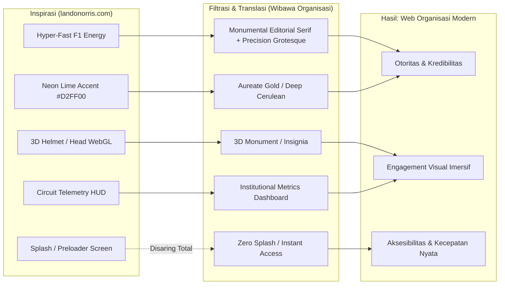
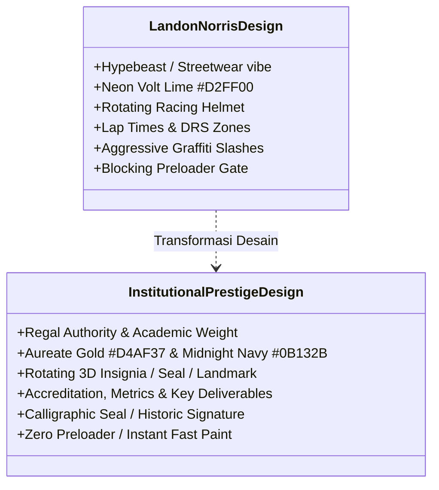
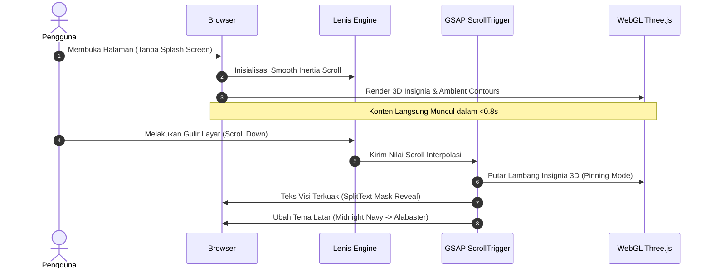

# DESIGN SYSTEM & UI/UX SPECIFICATION: INSTITUTIONAL PRESTIGE
> **Adaptasi Konsep Desain Modern & Kinetik `landonorris.com` ke Ranah Organisasi Berwibawa**
> Status: *Definitive Draft* | Arsitektur: *Fluid Proportional System, GSAP ScrollTrigger, Lenis Smooth Scroll, WebGL/Three.js Insignia*

---

## 1. Eksekutif & Filosofi Desain

Dokumen ini merumuskan transformasi menyeluruh dari arsitektur UI/UX situs personal atlet Formula 1 kelas dunia ([landonorris.com](https://landonorris.com/)) ke dalam ekosistem digital **situs web organisasi / institusi**. Tujuannya adalah mengadopsi ketajaman visual, kedalaman teknologi (3D/WebGL), tipografi editorial kinetik, dan efisiensi telemetri modern, sembari menyaring elemen agresif/esports agar tetap memancarkan **wibawa, integritas, kepemimpinan, dan kepercayaan publik (institutional dignity)**.



### Pilar Prinsip Utama:
1. **Zero Preloader, Instant Access**: Menghilangkan 100% splash screen, preloader barrier, dan modal transisi pembuka. Pengguna langsung disuguhkan konten primer secara instan dengan *first meaningful paint* di bawah 0.8 detik.
2. **Authority Through Precision (Presisi Telemetri)**: Mengadopsi format *HUD (Heads-Up Display)* dan kartu *Bento Box* F1 untuk menampilkan data organisasi (capaian akreditasi, statistik anggota/mahasiswa, peta jalan strategis) secara transparan dan berwibawa.
3. **Dual-Track Paradigm (Kiprah Resmi vs. Pengabdian Komunitas)**: Mengadaptasi pembagian halaman *"On-Track"* (balapan resmi) dan *"Off-Track"* (kehidupan sosial) menjadi **"Formal Track"** (tata kelola, regulasi, sidang, kepemimpinan) dan **"Community Track"** (pengabdian masyarakat, riset terapan, inovasi, human story).
4. **Fluid Proportional Canvas**: Tata letak yang berskala mulus (*fluid typography & layout*) dari resolusi 320px hingga 1920px berbasis CSS `clamp()` dan kalkulasi rasio viewport dinamis.

---

## 2. Analisis Dekomposisi `landonorris.com`

Berdasarkan ekstraksi langsung pada struktur DOM, lembar gaya CSS, dan berkas JavaScript (`lando.OFF+BRAND.js`, `transitions-rive-isolate.js`), berikut adalah temuan teknis dan estetika intinya:

### 2.1. Arsitektur Teknologi & Library Stack
- **Smooth Scrolling Engine**: `@studio-freight/lenis` (Lenis v1.x) untuk inersia gulir yang mulus tanpa mengorbankan native scroll wheel.
- **Motion & Scroll Choreography**: `GSAP 3` dipadukan dengan `ScrollTrigger` (94 instance terdaftar) untuk mengontrol *pinning* elemen 3D, *horizontal-track scrub*, dan *split-text reveals*.
- **3D & Shader Rendering**: `Three.js` (197 referensi) dengan custom GLSL shaders (385 serapan uniforms) untuk efek latar belakang cairan topografi dinamis (*ambient airflow streamline*) dan rendering 3D helm/kepala interaktif.
- **Vector State Machines**: `Rive` engine untuk diagram lintasan sirkuit dinamis dan status tombol interaktif.
- **Tipografi Utama**: `Mona Sans Variable` (GitHub) dipadukan dengan display serif beraliran Didone/Bodoni berkontras ekstrem.

### 2.2. Pola Visual Kunci yang Ditemukan
| Komponen | Implementasi pada `landonorris.com` | Rasionil Penggunaan |
| :--- | :--- | :--- |
| **Hero Section** | Objek 3D (kepala Lando + helm) berada di tengah kanvas dengan latar kontur cairan WebGL; teks judul editorial mengapung di latar belakang. | Menghadirkan *focal point* dramatis yang langsung mengunci atensi visual pengunjung dalam detik pertama. |
| **HUD Corner Card** | Kotak mini bersudut *chamfer* di kiri bawah menampilkan sirkuit aktif (*Next Race: São Paulo GP*) dan logo McLaren F1. | Menyajikan informasi waktu-nyata (*telemetry*) tanpa menyumbat kanvas utama. |
| **Kinetic Marquee** | Teks berjalan raksasa horizontal dengan perpaduan kata serif klasik dan sans-serif tebal berwarna neon lime. | Membangun ritme visual dan memecah kebosanan grid statis konvensional. |
| **Pinned Helmet Scrub** | Saat menggulir ke bawah, helm 3D tetap terkunci di tengah layar (*fixed pin*), sementara baris teks moto editorial melintas di belakangnya. | Efek kedalaman 3D berlapis (*z-index layering*) yang elegan. |
| **Interactive 3D Visualizer** | Model lintasan sirkuit 3D isometrik dengan pita cahaya neon, titik DRS, nomor tikungan, dan rotasi interaktif. | Mentransformasi data lintasan balap kering menjadi pengalaman eksplorasi interaktif. |
| **Bento Grid Telemetry** | Kartu modular bergaris batas tipis (*hairline border*) menampilkan angka ronde, bendera negara, posisi, dan nomor mobil (#4). | Penyusunan data asimetris dengan keterbacaan tinggi. |

---

## 3. Matriks Transformasi: Menjaga "Wibawa Organisasi"

Penerapan konsep visual atlet/esports ke website organisasi memerlukan kalibrasi ketat agar tidak terkesan murahan (*tacky*), ugal-ugalan, atau main-main.



### 3.1. Komparasi Detail Adaptasi

| Elemen Desain | Pada `landonorris.com` (Gaya Pembalap F1) | Adaptasi pada Website Organisasi (Wibawa Institusi) |
| :--- | :--- | :--- |
| **Palet Warna** | Hitam pekat, hijau zaitun balap, dan **Neon Lime `#D2FF00`**. | **Midnight Navy `#0A1128`**, **Imperial Emerald `#0C231E`**, dan aksen **Prestige Gold `#D4AF37` / Deep Cyan `#00B4D8`**. Memberikan sinyal kehormatan, stabilitas, dan intelektualitas. |
| **Tipografi Judul** | Huruf display tebal sans-serif dipadu serif eksperimental dan coretan grafiti kasual. | **Monumen Editorial Serif** (*Playfair Display* / *Cormorant*) untuk tajuk kepemimpinan & visi misi, dipadu **Mona Sans Variable** untuk body & data teknis. Coretan grafiti diganti dengan **Tanda Tangan Resmi Pimpinan / Kaligrafi Monogram Cap Resmi**. |
| **Focal Centerpiece 3D** | Helm balap 3D berganti corak (*gold camo*). | **Lambang/Insignia 3D Organisasi** (misal: Maket Gedung Rektorat, Tugu Monumen, Medali Penghargaan, atau Lambang Garuda/Pena/Buku) yang dirender secara fotorealistik dengan material perunggu, emas tua, atau marmer kaca. |
| **HUD Card Pojok Kiri Bawah** | Sirkuit balap berikutnya (*São Paulo GP*). | **Institutional Live Badge**: Status akreditasi ("Akreditasi Unggul BAN-PT"), Waktu Sidang Terbuka Terdekat, atau Hitung Mundur Dies Natalis / Rapat Kerja Nasional. |
| **Track Visualizer 3D** | Model sirkuit balap Formula 1 dengan lampu pita neon. | **Peta Jalan Strategis 3D (Strategic Roadmap Visualizer)**: Lintasan 3D yang menggambarkan fase pencapaian rencana strategis organisasi (Tahun 2025: Fondasi Riset -> 2026: Rekognisi Internasional -> 2027: Hilirisasi Industri) lengkap dengan titik target (*milestones*). |
| **Bento Grid Data** | Telemetri balapan: Putaran 71 lap, finis ke-5, kecepatan lap. | **Bento Metrics Prestasi**: Rasio Kelulusan, Dana Hibah Riset Aktif, Jumlah Publikasi Terindeks Scopus, Jejaring Mitra Global, Indeks Kepuasan Layanan Publik. |
| **Dua Lajur Konten** | *On-Track* (di sirkuit) & *Off-Track* (di luar sirkuit). | **Jalur Tata Kelola (Formal Governance Track)**: Kebijakan, Senat, Dokumen Resmi, SK, Laporan Keuangan; dan **Jalur Pengabdian (Impact & Community Track)**: Program kemitraan, prestasi mahasiswa, keterlibatan masyarakat, inovasi lapangan. |

---

## 4. Spesifikasi Desain Token & Visual Identity

### 4.1. Color Palette (Variabel Token CSS)
Skema warna didesain dalam sistem dual-theme dinamis (*Formal Dark Mode* untuk aspek prestisius seremonial, dan *Editorial Alabaster Light Mode* untuk membaca laporan panjang):

```css
:root {
  /* --- PALET UTAMA: PRESTIGE DARK (Untuk Hero, Peta Jalan, & Seremonial) --- */
  --color-prestige-midnight: #090e1a;   /* Latar belakang utama: Biru malam agung */
  --color-prestige-navy:     #0f172a;   /* Kontainer kartu HUD */
  --color-prestige-border:   rgba(212, 175, 55, 0.22); /* Garis batas emas halus */
  --color-prestige-surface:  rgba(15, 23, 42, 0.75);  /* Glassmorphism panel */

  /* --- WARNA AKSEN: KEHORMATAN & ENERGI INTELEKTUAL --- */
  --color-accent-gold:       #d4af37;   /* Emas simbol kejayaan dan martabat */
  --color-accent-gold-glow:  rgba(212, 175, 55, 0.4);
  --color-accent-cyan:       #00d2ff;   /* Biru listrik modern untuk metrik teknologi */
  --color-accent-emerald:    #00e599;   /* Hijau integritas untuk status 'Aktif' */

  /* --- PALET KEDUA: EDITORIAL ALABASTER (Untuk Halaman Dokumen & Berita) --- */
  --color-paper-light:       #fcfbf7;   /* Warna kertas hangat elegan */
  --color-paper-stone:       #f1ede4;   /* Panel kartu mode terang */
  --color-text-primary:      #121826;   /* Teks utama: Charcoal pekat */
  --color-text-muted:        #64748b;   /* Teks pendukung */
  --color-text-inverted:     #f8fafc;   /* Teks di atas latar gelap */

  /* --- SISTEM TIMING & EASING (Diturunkan dari studi landonorris.com) --- */
  --cubic-prestige:          cubic-bezier(0.65, 0.05, 0, 1);
  --duration-smooth:         0.75s;
  --duration-fast:           0.25s;
  --anim-default:            var(--duration-smooth) var(--cubic-prestige);

  /* --- RADIUS & GEOMETRI --- */
  --radius-card:             10px;      /* Sudut tegas modern */
  --radius-pill:             999px;     /* Tombol aksi utama */
  --radius-chamfer:          14px;      /* Sudut potong teknis */
}
```

### 4.2. Tipografi & Hierarki Font
Mengadopsi pendekatan dwi-font:
1. **Editorial Display Serif**: `Cormorant Garamond` atau `Playfair Display` (Google Fonts, bebas lisensi komersial).
   - Penggunaan: Judul utama halaman, kutipan pimpinan, moto Dies Natalis, angka tahun capaian.
2. **Modern Grotesque Sans**: `Mona Sans Variable` atau `Inter Variable`.
   - Penggunaan: Navigasi, teks paragraf, tombol aksi, label HUD.
3. **Monospace Metadata**: `JetBrains Mono` atau `Fira Code`.
   - Penggunaan: Nomor registrasi surat, waktu rapat, kode SK, koordinat GPS kampus/kantor.

```css
/* Kalkulasi Tipografi Skala Proposional Fleksibel (Fluid Scaling) */
:root {
  --fluid-min-width: 992px;
  --fluid-max-width: 1920px;
  --design-canvas-width: 1728;
  --font-base-unit: 16;

  --font-fluid-container: clamp(var(--fluid-min-width), 100vw, var(--fluid-max-width));
  --font-fluid-base: calc(var(--font-fluid-container) / var(--design-canvas-width) * var(--font-base-unit));

  --font-serif-display: "Cormorant Garamond", Georgia, serif;
  --font-sans-body: "Mona Sans Variable", "Inter", -apple-system, sans-serif;
  --font-mono-data: "JetBrains Mono", Consolas, monospace;
}

h1.hero-monument-title {
  font-family: var(--font-serif-display);
  font-size: clamp(3.2rem, 7vw, 7.5rem);
  font-weight: 700;
  letter-spacing: -0.02em;
  line-height: 0.95;
  text-transform: uppercase;
}

.hud-eyebrow-label {
  font-family: var(--font-mono-data);
  font-size: 0.75rem;
  letter-spacing: 0.12em;
  text-transform: uppercase;
  color: var(--color-accent-gold);
}
```

---

## 5. Arsitektur Komponen Antarmuka (UI Blueprint)

### 5.1. Header Navigasi Dinamis Adaptif
Header melayang di bagian atas dengan status latar adaptif (*glassmorphism* tembus pandang) yang membaca warna bagian di bawahnya secara otomatis:
- **Kiri**: Lambang & Nama Institusi (Tipografi formal dengan monogram vektor SVG presisi).
- **Tengah**: Menu navigasi utama (`Beranda`, `Tata Kelola`, `Kiprah & Riset`, `Peta Jalan`, `Layanan Digital`).
- **Kanan**:
  - Tombol Utama Aksen Emas: `PORTAL LAYANAN ↗` (Tombol pill bergaris batas halus dengan efek kilau saat *hover*).
  - Tombol Menu Kompak (*Drawer Toggle*) untuk akses cepat daftar direktori civitas/organisasi.

### 5.2. Hero Section: The Institutional Monument Canvas
Menggantikan helm pembalap dengan model 3D simbol kehormatan organisasi:

```
+-------------------------------------------------------------------------------+
| [LOGO ORGANISASI]           BERANDA   TATA KELOLA   KIPRAH   PETA JALAN        [PORTAL UTAMA ↗] [=] |
|                                                                               |
|                     MENEGAKKAN ILMU, MENGABDI                                |
|                                                                               |
|                             +---------------+                                 |
|                             |               |                                 |
|                             |    3D LOGO    |                                 |
|                             |   INSIGNIA    |                                 |
|                             |   INTERAKTIF  |                                 |
|                             |   (BERPUTAR   |                                 |
|                             |    HALUS)     |                                 |
|                             +---------------+                                 |
|                                                                               |
|                           UNTUK KEDAULATAN BANGSA                             |
|                                                                               |
|  +--------------------+                                                       |
|  | [HUD BADGE]        |                                 [ 01 / 04 : VISI 2030 ]|
|  | AKREDITASI: UNGGUL |                                 [ GULIR EKSPLORASI ↓ ] |
|  | SIDANG: 18 NOV     |                                                       |
|  +--------------------+                                                       |
+-------------------------------------------------------------------------------+
```

1. **Kanvas Latar Belakang (Ambient WebGL)**: Menghasilkan garis kontur cairan topografis halus yang bergerak lambat (kecepatan 0.05x dari situs Lando), melambangkan peta bentang alam nusantara dan aliran data riset.
2. **Insignia 3D di Tengah**:
   - Model 3D Three.js dengan material *PBR (Physically Based Rendering)*: kuningan bertekstur, marmer, dan kaca akrilik.
   - Merespons pergerakan kursor (*subtle parallax tilt*) maksimal 8 derajat agar tetap terasa anggun dan tidak membuat pusing.
3. **Live Telemetry HUD Widget (Pojok Kiri Bawah)**:
   - Garis pembatas tipis berwarna emas redup dengan sudut *chamfer* 45 derajat.
   - Menampilkan status langsung: Nomor Akreditasi Internasional, Agenda Sidang Terdekat, dan Tombol Cepat Unduh Laporan Tahunan.

### 5.3. Bento Metrics Grid (Pusat Data Kinerja Organisasi)
Mengadaptasi kartu statistik balapan F1 menjadi matriks pencapaian berwibawa:

```
+---------------------------------------------------------------------------------+
|  +--------------------------------+  +-------------------+  +----------------+  |
|  | CAPAIAN AKREDITASI             |  | PUBLIKASI GLOBAL  |  | RATING IKU     |  |
|  |                                |  |                   |  |                |  |
|  |    UNGGUL (BAN-PT)             |  |    1,428 DOKUMEN  |  |   PERINGKAT 1  |  |
|  |    Sertifikasi Internasional   |  |    Terindeks      |  |   Klaster Mandiri| |
|  |    ASIIN & ABEST21             |  |    Scopus / WoS   |  |   Tahun 2025/2026| |
|  +--------------------------------+  +-------------------+  +----------------+  |
|  +-------------------------------------------------------+  +----------------+  |
|  | AGENDA STRATEGIS TERDEKAT                             |  | CALL CENTER    |  |
|  | Rapat Terbuka Senat Akademik & Penganugerahan Doktor  |  | 24/7 Terpadu   |  |
|  | 24 November 2026 - Auditorium Pusat                   |  | Layanan Prima  |  |
|  +-------------------------------------------------------+  +----------------+  |
+---------------------------------------------------------------------------------+
```

### 5.4. Peta Jalan Strategis 3D (Adaptasi Track Visualizer)
Pada `landonorris.com`, pengunjung dapat menginspeksi sirkuit F1 dalam bentuk 3D bercahaya. Pada website organisasi, komponen ini diadaptasi menjadi **"3D Strategic Roadmap Visualizer"**:
- Garis lintasan isometrik Three.js / WebGL yang bercahaya emas halus merepresentasikan perjalanan organisasi dari tahun ke tahun.
- Setiap tikungan (*turn*) merepresentasikan **Tonggak Capaian (Strategic Milestone)**:
  - *Checkpoint 01*: Transformasi Digital & Penguatan Tata Kelola (2024).
  - *Checkpoint 02*: Hilirisasi Riset Terapan & Kerjasama Industri Strategis (2025).
  - *Checkpoint 03*: Ekspansi Reputasi Global & Akreditasi Mancanegara (2026).
- Pengguna dapat mengklik tombol rotasi (`⟲`, `⟳`) atau menyeret kursor untuk memutar lintasan dan melihat detail capaian pada kartu pop-up yang menyertainya.

### 5.5. Dual-Track Transition: "Tata Kelola Formal" vs "Karya Pengabdian"
- **Formal Track (Tema Gelap - Deep Midnight & Gold)**:
  - Fokus: Statuta, Keputusan Rapat, Regulasi, Transparansi Finansial, Struktur Pengurus.
  - Tipografi: Tegas, formal, dengan garis tepi *hairline*.
- **Community Track (Tema Terang - Warm Alabaster & Forest Green)**:
  - Saat pengguna menggulir ke seksi ini, latar belakang bermutasi dengan transisi CSS halus 0.8 detik menjadi terang benderang.
  - Fokus: Dokumentasi humanis pengabdian masyarakat, beasiswa, kehidupan kampus/komunitas, galeri foto asimetris berkualitas tinggi.

---

## 6. Motion Design System & Implementasi Interaksi

Semua animasi mengikuti prinsip kepatutan institusional: **halus (*graceful*), bertujuan jelas (*purposeful*), dan tidak membuat lelah mata (*fatigue-free*)**.



### 6.1. Inisialisasi Lenis & GSAP ScrollTrigger

```javascript
import Lenis from '@studio-freight/lenis';
import { gsap } from 'gsap';
import { ScrollTrigger } from 'gsap/ScrollTrigger';

gsap.registerPlugin(ScrollTrigger);

// Inisialisasi Smooth Scroll Lenis
const lenis = new Lenis({
  duration: 1.2,
  easing: (t) => Math.min(1, 1.001 - Math.pow(2, -10 * t)), // Expo-Out Easing
  direction: 'vertical',
  gestureDirection: 'vertical',
  smooth: true,
  smoothTouch: false, // Jaga performa di mobile
  touchMultiplier: 2,
});

// Sinkronisasi Lenis dengan GSAP ScrollTrigger
lenis.on('scroll', ScrollTrigger.update);

gsap.ticker.add((time) => {
  lenis.raf(time * 1000);
});
gsap.ticker.lagSmoothing(0);
```

### 6.2. Animasi Pinning Centerpiece & Kinetic Typography Reveal

```javascript
// Mengunci Model 3D di Tengah Layar sembari Teks Visi Bergulir di Belakangnya
ScrollTrigger.create({
  trigger: ".hero-pinned-wrapper",
  start: "top top",
  end: "+=2000",
  pin: ".insignia-3d-canvas-container",
  scrub: 1,
  onUpdate: (self) => {
    // Putar sudut objek 3D mengikuti kecepatan gulir
    if (window.insigniaMesh) {
      window.insigniaMesh.rotation.y = self.progress * Math.PI * 1.5;
    }
  }
});

// Teks Paragraf Visi Muncul Per-Baris dengan Masking Halus
gsap.utils.toArray('.split-reveal-line').forEach((line) => {
  gsap.fromTo(line, 
    { y: '100%', opacity: 0 },
    {
      y: '0%',
      opacity: 1,
      duration: 1.0,
      ease: 'power3.out',
      scrollTrigger: {
        trigger: line,
        start: 'top 85%',
        toggleActions: 'play none none reverse'
      }
    }
  );
});
```

### 6.3. Dynamic Header Theme Switcher

```javascript
// Mendeteksi Perubahan Warna Section untuk Menyesuaikan Warna Header
const navBar = document.querySelector('.main-institutional-nav');
const lightSections = document.querySelectorAll('[data-theme="light"]');

lightSections.forEach((sec) => {
  ScrollTrigger.create({
    trigger: sec,
    start: "top 60px",
    end: "bottom 60px",
    onEnter: () => navBar.classList.add('nav-theme-light'),
    onLeave: () => navBar.classList.remove('nav-theme-light'),
    onEnterBack: () => navBar.classList.add('nav-theme-light'),
    onLeaveBack: () => navBar.classList.remove('nav-theme-light'),
  });
});
```

---

## 7. Komponen Kode Baku (Ready-to-Use Snippets)

### 7.1. Struktur HTML Bento Metrics HUD (BEM Convention)

```html
<section class="inst-metrics" aria-label="Ringkasan Kinerja Organisasi">
  <div class="inst-metrics__container">
    
    <!-- Kartu Utama: Akreditasi -->
    <article class="inst-card inst-card--featured inst-card--chamfer">
      <div class="inst-card__header">
        <span class="inst-card__eyebrow">STATUS AKREDITASI NASIONAL & GLOBAL</span>
        <div class="inst-card__badge-icon" aria-hidden="true">★</div>
      </div>
      <div class="inst-card__body">
        <h3 class="inst-card__metric-headline">TERAKREDITASI UNGGUL</h3>
        <p class="inst-card__description">
          Memenuhi standar baku mutu pendidikan tinggi berdasarkan Keputusan Badan Akreditasi Nasional (BAN-PT) No. 412/SK/BAN-PT/2025.
        </p>
      </div>
      <div class="inst-card__footer">
        <span class="inst-card__meta-code">REG: ID-BANPT-9982</span>
        <a href="/dokumen/akreditasi" class="inst-card__link">Lihat Sertifikat Dokumen ↗</a>
      </div>
    </article>

    <!-- Kartu Sekunder: Riset & Hibah -->
    <article class="inst-card inst-card--secondary">
      <span class="inst-card__eyebrow">INDEX PUBLIKASI INTERNASIONAL</span>
      <div class="inst-card__number-display">
        <span class="inst-card__counter">1,480</span>
        <span class="inst-card__unit">Artikel</span>
      </div>
      <p class="inst-card__subtext">Terindeks pada pangkalan data bereputasi (Scopus Q1/Q2 & WoS).</p>
    </article>

    <!-- Kartu Agenda / Waktu Nyata -->
    <article class="inst-card inst-card--agenda">
      <span class="inst-card__eyebrow">AGENDA SIDANG TERBUKA TERDEKAT</span>
      <time datetime="2026-11-28" class="inst-card__agenda-date">28 NOVEMBER 2026</time>
      <h4 class="inst-card__agenda-title">Rapat Koordinasi Tahunan Pimpinan & Mitra Strategis</h4>
      <span class="inst-card__location">Auditorium Graha Krida Pratama, Pukul 09.00 WITA</span>
    </article>

  </div>
</section>
```

### 7.2. Lembar Gaya CSS Kartu Bento HUD

```css
.inst-metrics__container {
  display: grid;
  grid-template-columns: repeat(12, 1fr);
  gap: 1.5rem;
  max-width: 1440px;
  margin: 0 auto;
  padding: 3rem 2rem;
}

.inst-card {
  position: relative;
  background: var(--color-prestige-surface);
  backdrop-filter: blur(16px);
  -webkit-backdrop-filter: blur(16px);
  border: 1px solid var(--color-prestige-border);
  border-radius: var(--radius-card);
  padding: 2rem;
  color: var(--color-text-inverted);
  transition: transform var(--duration-fast) ease, border-color var(--duration-fast) ease;
}

.inst-card:hover {
  transform: translateY(-4px);
  border-color: var(--color-accent-gold);
}

.inst-card--featured {
  grid-column: span 7;
}

.inst-card--secondary {
  grid-column: span 5;
}

.inst-card--agenda {
  grid-column: span 12;
  display: flex;
  align-items: center;
  justify-content: space-between;
}

.inst-card--chamfer {
  clip-path: polygon(
    0 0, 
    calc(100% - 20px) 0, 
    100% 20px, 
    100% 100%, 
    0 100%
  );
}

.inst-card__eyebrow {
  display: block;
  font-family: var(--font-mono-data);
  font-size: 0.75rem;
  color: var(--color-accent-gold);
  letter-spacing: 0.1em;
  margin-bottom: 0.75rem;
}

.inst-card__metric-headline {
  font-family: var(--font-serif-display);
  font-size: 2.5rem;
  font-weight: 700;
  line-height: 1.1;
  color: #ffffff;
  margin: 0.5rem 0 1rem;
}

.inst-card__number-display {
  display: flex;
  align-items: baseline;
  gap: 0.5rem;
  margin: 1rem 0;
}

.inst-card__counter {
  font-family: var(--font-sans-body);
  font-size: 3.5rem;
  font-weight: 800;
  color: var(--color-accent-gold);
  line-height: 1;
}

@media (max-width: 991px) {
  .inst-card--featured,
  .inst-card--secondary,
  .inst-card--agenda {
    grid-column: span 12;
    flex-direction: column;
    align-items: flex-start;
  }
}
```

---

## 8. Panduan Aksesibilitas (WCAG 2.1 AA) & Etika Antarmuka

Website organisasi mengemban mandat pelayanan publik untuk semua kalangan (termasuk lansia, penyandang disabilitas, dan perangkat dengan koneksi terbatas). Oleh karena itu, prinsip-prinsip berikut wajib dipenuhi:

1. **Rasio Kontras Warna (Color Contrast)**:
   - Teks normal pada latar belakang gelap wajib memiliki rasio kontras minimal **4.5:1** (Teks putih `#FFFFFF` pada latar `#090E1A` menghasilkan kontras **17.8:1**, sangat aman).
   - Aksen Emas `#D4AF37` hanya digunakan untuk elemen dekoratif, garis tepi, ikon, atau teks tebal berukuran besar (>24px) guna menjamin keterbacaan.
2. **Kepatuhan `prefers-reduced-motion`**:
   Bagi pengguna yang mengaktifkan mode hemat gerak atau sensitif terhadap animasi berputar:
   ```css
   @media (prefers-reduced-motion: reduce) {
     *, ::before, ::after {
       animation-duration: 0.01ms !important;
       animation-iteration-count: 1 !important;
       transition-duration: 0.01ms !important;
       scroll-behavior: auto !important;
     }
     .insignia-3d-canvas-container {
       display: none; /* Gantilah dengan gambar vektor SVG statis beresolusi tinggi */
     }
     .insignia-fallback-image {
       display: block;
     }
   }
   ```
3. **Navigasi Keyboard & Focus Indicators**:
   - Seluruh tautan, tombol, dan komponen interaktif wajib memiliki cincin fokus (*focus ring*) yang jelas terlihat saat ditekan via tombol `Tab`:
   ```css
   :focus-visible {
     outline: 2px solid var(--color-accent-gold);
     outline-offset: 4px;
   }
   ```
4. **Semantik Layar Pembaca (Screen Readers)**:
   - Komponen visual 3D Three.js dan dekorasi garis WebGL wajib diberi atribut `aria-hidden="true"`.
   - Data telemetri dan angka kinerja wajib dilengkapi teks eksplisit tersembunyi (*visually-hidden text*) agar terbaca secara gramatikal oleh pembaca layar tunanetra.

---

## 9. Kesimpulan & Roadmap Eksekusi

Dengan mengadaptasi formula visual dari [landonorris.com](https://landonorris.com/) melalui saringan institusional ini, organisasi memperoleh kehadiran digital yang:
1. **Sangat Kompetitif & Visioner**: Menembus kebiasaan desain instansi pemerintah/kampus yang kerap kaku, kuno, dan membosankan.
2. **Tetap Berwibawa & Kredibel**: Menjaga martabat organisasi melalui tata warna agung, tipografi monumen yang anggun, serta data capaian yang terukur.
3. **Cepat & Tanggap**: Memberikan pengalaman jelajah instan tanpa hambatan loading screen, dengan fluiditas navigasi standar dunia.

